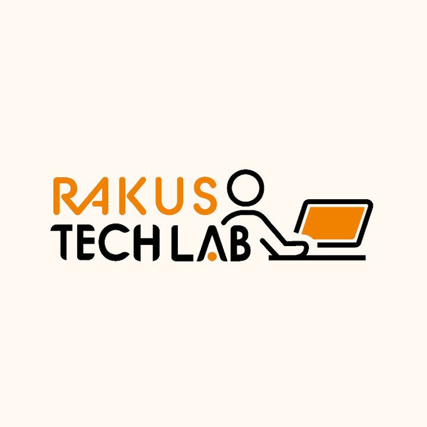
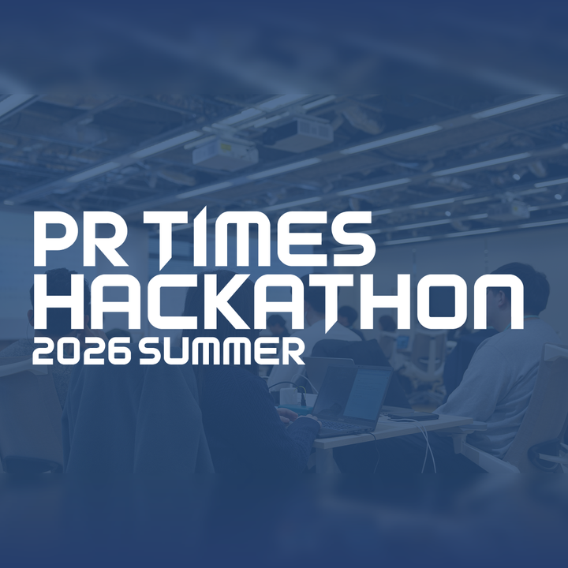
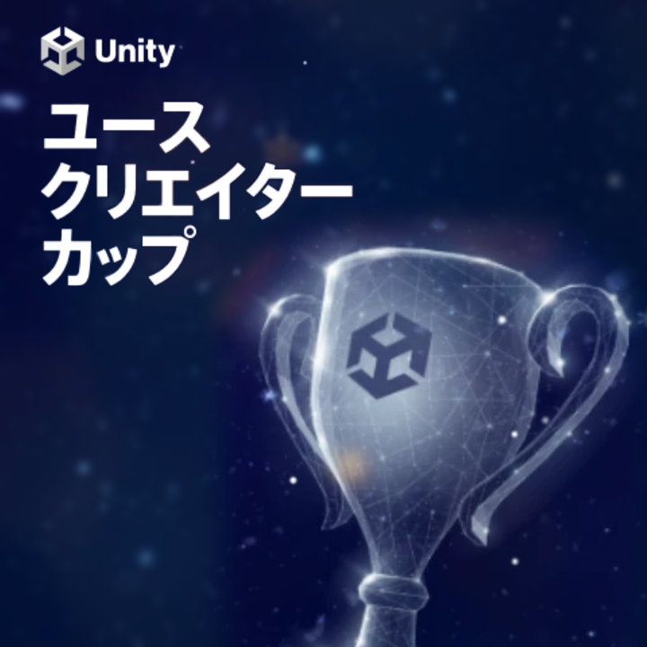
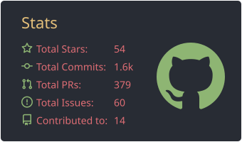
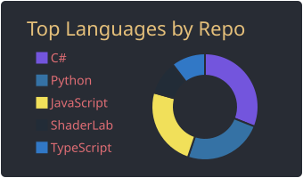

  
  
  

## Skills

<table>
  <tr><th width="160">分野</th><th width="672">経験</th></tr>
  <tr><td><b>Unity</b></td><td>ゲーム開発ならびに物理シミュレーション</td></tr>
  <tr><td><b>Blender</b></td><td>3DCG制作、ジオメトリノードを用いた動的モデル生成</td></tr>
  <tr><td><b>Python</b></td><td>ハンドジェスチャ推定モデル開発、データ分析ツールの開発</td></tr>
  <tr><td><b>Web</b></td><td>フロントエンド: JSによるWebアプリ バックエンド: サーバのホスティング</td></tr>
</table>

## Experience

<table>
  <tr>
    <td width="130" align="center"></td>
    <td width="702"><b>Fujitsu Internship</b> 2026</td>
  </tr>
  <tr>
    <td align="center"></td>
    <td><b>RAKUS Tech Lab</b> 2026</td>
  </tr>
  <tr>
    <td align="center"></td>
    <td><b>PR TIMES HACKATHON</b> 2026</td>
  </tr>
  <tr>
    <td align="center"></td>
    <td><b>Unity ユースクリエイターカップ</b> 2021, 2022（<a href="https://github.com/mimisukeMaster/OsakanaFlock">OsakanaFlock</a>）</td>
  </tr>
</table>

## Projects

<table>
  <tr>
    <td width="50%" valign="top">
      
       <b>Simulation of Universal Gravitation</b>
       Compute Shader (GPGPU) による万有引力のシミュレーション
    </td>
    <td width="50%" valign="top">
      
       <b>AI-VOICEVOX</b>
       複数のLLMが回答・ディベートし、VOICEVOXで読み上げるWebアプリ
    </td>
  </tr>
  <tr>
    <td width="50%" valign="top">
      
       <b>BodyTrackingAnalyzer</b>
       Azure Kinectの骨格トラッキングを可視化し、座標データを分析するツール
    </td>
    <td width="50%" valign="top">
      
       <b>Morning Hut</b>
       3DCG作品（from ArtStation）
    </td>
  </tr>
  <tr>
    <td width="50%" valign="top">
      
       <b>MarkovChainGenerator</b>
       マルコフ連鎖によるランダムな文章の生成
    </td>
    <td width="50%" valign="top">
      

      <b>mandelbrot-visualizer</b>
       Pythonで生成するマンデルブロ集合のビューア
    </td>
  </tr>
</table>

Other works (3DCG, Game)

  
  

## Technologies 

<table>
  <tr>
    <td width="160"><b>Languages</b></td>
    <td width="672">
      
      
      
      
      
      
      
    </td>
  </tr>
  <tr>
    <td><b>Game / Visual Contents</b></td>
    <td>
      
      
      
      
    </td>
  </tr>
  <tr>
    <td><b>Web</b></td>
    <td>
      
      
      
      
      
      
    </td>
  </tr>
  <tr>
    <td><b>Music</b></td>
    <td>
      
      
      
    </td>
  </tr>
  <tr>
    <td><b>Tools</b></td>
    <td>
      
      
    </td>
  </tr>
  <tr>
    <td><b>Others</b></td>
    <td>
      
      
      
    </td>
  </tr>
</table>

## GitHub Stats

  
  
   
  
  

  

## SNS

  
  &nbsp;
  

